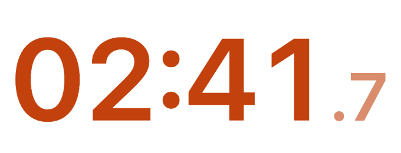

# Onscreen Stopwatch

A stopwatch for screen recordings. The page shows the time and nothing else.

<table>
  <tr>
    <td align="center">
       
      Dark theme, running
    </td>
    <td align="center">
       
      Light theme, stopped
    </td>
  </tr>
</table>

## Why

A screen recording often has a long wait in the middle of a task. You cut the wait, and then the viewer cannot tell how long the task took.

Keep this stopwatch in the frame. After the cut, the time jumps, and the viewer sees how long the task took.

## Use

Open the [hosted page](https://zachvictor.github.io/onscreen-stopwatch/).

To use the stopwatch offline, download `index.html` and open it in a browser. The page is one file. It needs no server and no build step.

The time scales to fill the window, so the window can be small.

## Keyboard shortcuts

| Key              | Action                                            | Mouse                       |
|------------------|---------------------------------------------------|-----------------------------|
| <kbd>Space</kbd> | Start or stop the stopwatch                       | Click the time              |
| <kbd>R</kbd>     | Reset the stopwatch to zero                       | Click **Reset**             |
| <kbd>F</kbd>     | Float the stopwatch (see [Float](#float))         | Click **Float**             |
| <kbd>T</kbd>     | Switch between the dark theme and the light theme | Click **Light** or **Dark** |

- The keys work only while the stopwatch window has focus.
- Each key also has a button, and each button shows its key.
- The buttons appear after the pointer rests on the window for a moment. A quick click on the time does not show them.

## Colors

The color of the time shows the state of the stopwatch.

| State   | Dark theme | Light theme |
|---------|------------|-------------|
| At zero | Grey       | Grey        |
| Running | White      | Black       |
| Stopped | Yellow     | Orange      |

The dark theme is the default. The browser remembers the theme that you select.

## Float

Float moves the stopwatch into a small window that stays on top of other windows. Close that window to return the stopwatch to the tab.

Float uses the [Document Picture-in-Picture API](https://developer.mozilla.org/en-US/docs/Web/API/Document_Picture-in-Picture_API). Chrome and Edge support this API. The Float button does not appear in a browser that does not support it.

## Accuracy

The stopwatch reads the monotonic clock of the browser (`performance.now()`). It does not count ticks, so a hidden or throttled window does not lose time.

The display shows tenths of a second. It truncates the time and does not round it.

## Tested

Chrome 158 on macOS.

## License

[MIT](LICENSE)
